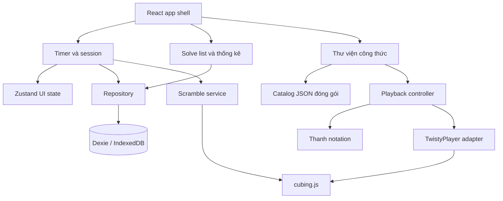
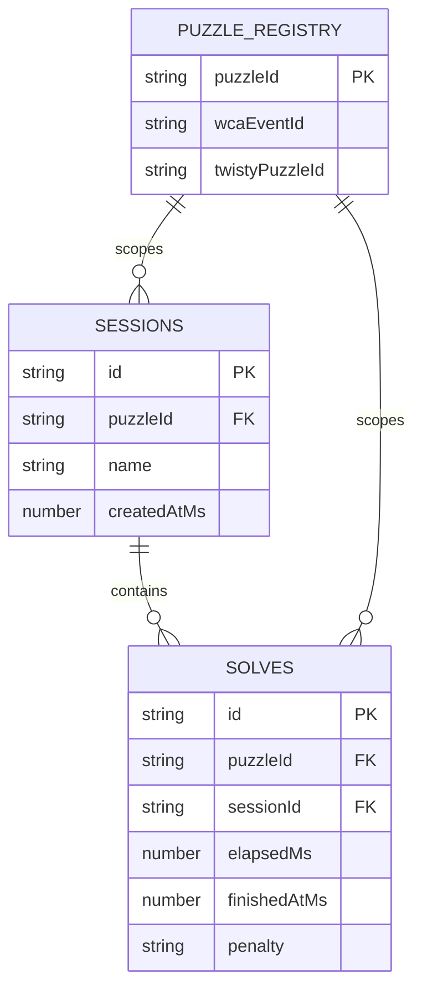
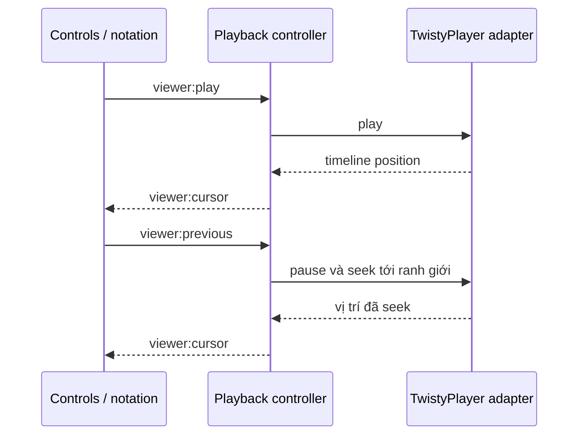

# Kiến trúc CubeTimer

CubeTimer là ứng dụng luyện speedcubing offline-first. Một frontend Vite + React + TypeScript phục vụ Web PWA, desktop Tauri và mobile Capacitor. Tailwind CSS đảm nhiệm giao diện, Lucide cung cấp biểu tượng và Zustand giữ trạng thái tương tác. Dexie quản lý dữ liệu luyện tập trong IndexedDB. `cubing.js` cung cấp scramble, notation, mô hình puzzle và `<twisty-player>`.

## Ranh giới mô-đun



| Mô-đun | Trách nhiệm |
| --- | --- |
| Timer | Chuẩn hóa đầu vào, quản lý vòng đời lượt giải và chụp context tại lúc bắt đầu. |
| Session/solve repository | Xác thực liên kết, thực thi transaction, truy vấn và theo dõi thay đổi theo scope. |
| Statistics | Tính Single, Ao5, Ao12 và Mean theo thứ tự gốc. Giao diện áp dụng chế độ hiển thị và thứ tự sau đó. |
| Scramble service | Ánh xạ `puzzleId` sang event, yêu cầu scramble và bỏ qua kết quả đến muộn. |
| Catalog | Đọc và kiểm tra dữ liệu Method → Step → Case → Variant. |
| Playback controller | Giữ cursor và chế độ. Chuyển lệnh người dùng thành thao tác trên adapter và phát snapshot cho React. |
| TwistyPlayer adapter | Cô lập API của `cubing.js`, áp dụng setup, quản lý camera và đưa vị trí timeline về dạng cursor. |

IndexedDB là nguồn dữ liệu bền vững cho session và solve. Zustand giữ lựa chọn UI và state machine hiện tại. Repository có thể dùng Dexie `liveQuery` để cập nhật giao diện sau khi ghi dữ liệu. Catalog công thức đọc từ asset cùng phiên bản với bản build.

## IndexedDB



`PUZZLE_REGISTRY` là cấu hình TypeScript đóng gói. Dexie v1 có hai object store `sessions` và `solves`. `[puzzleId+sessionId+finishedAtMs+id]` cho phép đọc solve theo scope và thứ tự ổn định. Repository kiểm tra khóa ngoại trong transaction vì IndexedDB chỉ quản lý khóa và index. Đổi `puzzleId` chọn lại session hợp lệ cho puzzle đó hoặc tạo session mặc định. UI chỉ đưa dữ liệu lên màn hình khi kết quả truy vấn thuộc scope hiện tại. Xem [hợp đồng dữ liệu](API_AND_DATA_SPEC.md) và [tài liệu compound index của Dexie](https://dexie.org/docs/Compound-Index).

## Luồng timer và scramble

1. `idle → holding → armed → running → saving → idle`. Nhấn giữ Space hoặc vùng timer 300 ms để chuyển sang `armed`. Nhả sớm trở về `idle`. Nhả sau khi armed bắt đầu đo. Lần nhấn tiếp theo dừng và ghi solve. Bỏ qua key repeat và lần nhả của thao tác dừng.
2. Dùng Pointer Events và một pointer chính cho vùng timer. Bỏ qua Space trong ô nhập liệu và điều khiển có hành vi bàn phím riêng. `blur`, `pointercancel` và mất pointer capture hủy thao tác giữ chưa bắt đầu. Đồng hồ đang chạy tiếp tục trong vòng đời trang hiện tại.
3. Chụp `puzzleId`, `sessionId`, `scramble` và ID solve lúc bắt đầu. Khóa chuyển puzzle/session lúc chạy và lưu. Dùng `performance.now()` để tính thời lượng và `Date.now()` để ghi mốc kết thúc. Tính lại từ thời điểm bắt đầu khi render, kể cả sau khi tab nền được mở lại.
4. Nếu ghi thất bại, giữ bản ghi chờ và cho phép thử lưu lại với cùng ID. Một lần dừng chỉ sinh một lượt giải. Tạo scramble kế tiếp sau khi ghi thành công.
5. Từ pha 4, `randomScrambleForEvent` chạy bất đồng bộ. Gắn mỗi yêu cầu với event và số thứ tự tăng dần. Chỉ áp dụng kết quả mới nhất của event hiện tại. Timer chỉ arm khi scramble tương ứng sẵn sàng. Pha 2–3 cho phép luyện tập với `scramble: null`.

Scramble và hình xem trước dùng cùng puzzle registry và cùng một giá trị scramble. Với sự kiện thi đấu chính thức, WCA yêu cầu chương trình scramble chính thức. [cubing.js Scramble](https://js.cubing.net/cubing/scramble/), [WCA Regulations](https://www.worldcubeassociation.org/regulations/).

## Đồng bộ Cube 3D và notation

### Cursor và token

Phân tích `alg` bằng `cubing/alg`. Mở rộng nhóm lặp, commutator và conjugate thành thứ tự thực thi. Tạo một token `<span>` cho mỗi `Move` đã mở rộng, dùng cùng chuỗi move cho player. Khoảng trắng, bình luận và ngắt dòng phục vụ trình bày. Một `R2`, `Rw` hoặc `x` chiếm một bước. Pha 6 dùng thuật toán đã chuẩn hóa không có pause node để ánh xạ 1–1.

`N` là tổng số move. `boundaryIndex` từ `0` đến `N` chỉ số move đã hoàn tất. `activeMoveIndex` từ `0` đến `N-1` chỉ move đang được nội suy hoặc move đang được chọn tại điểm dừng. Tại ranh giới `k > 0`, highlight move `k - 1`. Tại setup (`k = 0`), bỏ highlight. Khi pause giữa move, giữ highlight của move đó. `Next` áp dụng move đang dở đến hết hoặc tiến một ranh giới nếu đang đứng đúng ranh giới. `Previous` trở về đầu move đang dở hoặc lùi một ranh giới. Hai lệnh tự pause và chặn tại `0`/`N`.

### Hợp đồng đồng bộ nội bộ

```ts
type ViewerCommand =
  | { type: 'viewer:load'; variantId: string }
  | { type: 'viewer:play' | 'viewer:pause' | 'viewer:next' | 'viewer:previous' };

type ViewerCursor = {
  type: 'viewer:cursor';
  generation: number;
  boundaryIndex: number;
  activeMoveIndex: number | null;
  progress: number;
  status: 'paused' | 'playing' | 'ended';
};
```

`progress` thuộc `[0, 1)` trong move hiện tại và bằng `0` tại ranh giới. `status: 'ended'` nghĩa là player ở ranh giới `N`. Play tại `N` seek về `0` rồi phát lại. Lệnh seek phát snapshot khi player đến vị trí đích. React vẽ khung vuông trực tiếp từ `activeMoveIndex` và chỉ cần cập nhật phần notation khi index đổi.



Lấy cursor từ timeline thực tế của player. Adapter ánh xạ move và timestamp bằng indexer của bản `cubing.js` đã khóa phiên bản. Hàng đợi lệnh điều khiển tuần tự hóa các lần seek. Khi đổi variant, đổi chế độ hoặc unmount, pause, bỏ listener cũ và tăng `generation` để snapshot đến muộn mất hiệu lực. Pha 6 cần thử API đọc timeline, seek và input trên phiên bản đã pin trước khi triển khai controller. [TwistyPlayer API](https://js.cubing.net/cubing/api/classes/twisty.TwistyPlayer.html).

| Chế độ | Tương tác | Trạng thái khối |
| --- | --- | --- |
| Formula Viewer | Orbit camera bằng chuột/chạm. Tắt input xoay mặt. | Khởi tạo theo setup của variant rồi áp dụng move từ timeline. |
| Simulation | Xoay tầng và orbit camera bằng chuột/chạm. Kiểm tra gesture của adapter trên cả hai loại thiết bị. | Bắt đầu từ trạng thái hiển thị tại ranh giới ổn định gần nhất. Giữ biến đổi trong phiên mô phỏng. |

Khi về Viewer, khôi phục trạng thái variant và cursor đã chụp lúc vào Simulation. Nếu đang dở một move lúc chuyển chế độ, chụp ranh giới đã hoàn tất gần nhất. Camera có thể tiếp tục dùng góc nhìn người dùng đã chỉnh. Tách camera khỏi trạng thái xoay khối theo [hợp đồng dữ liệu](API_AND_DATA_SPEC.md).

## Đóng gói và lưu trữ theo nền tảng

| Đích | Phân phối | Kiểm tra offline |
| --- | --- | --- |
| Web PWA | Vite build, manifest, service worker trên HTTPS. Cache app shell, catalog, chunks, worker và asset cubing/WASM thực sự được dùng. | Mở online một lần, đợi cache sẵn sàng, ngắt mạng, tải lại và thử cả timer lẫn viewer. |
| Tauri desktop | Tauri dùng `frontendDist` trỏ tới `dist` của Vite. | Mở gói cài trên Windows, macOS và Linux, thử offline từ lần mở đầu tiên. |
| Capacitor mobile | `webDir` trỏ tới `dist`, đồng bộ assets vào dự án Android và iOS. | Mở app đóng gói offline, thử thao tác chạm, lưu solve rồi khởi động lại. |

Service worker chỉ đăng ký ở bản Web PWA. Bản native phục vụ assets đóng gói. Mỗi origin hoặc WebView có kho IndexedDB riêng. Pha 7 kiểm tra upgrade schema và cache trên dữ liệu đã có, giữ timer đang chạy trước khi người dùng áp dụng cập nhật web. [Tauri Frontend Configuration](https://v2.tauri.app/start/frontend/), [Capacitor Configuration](https://capacitorjs.com/docs/config).
